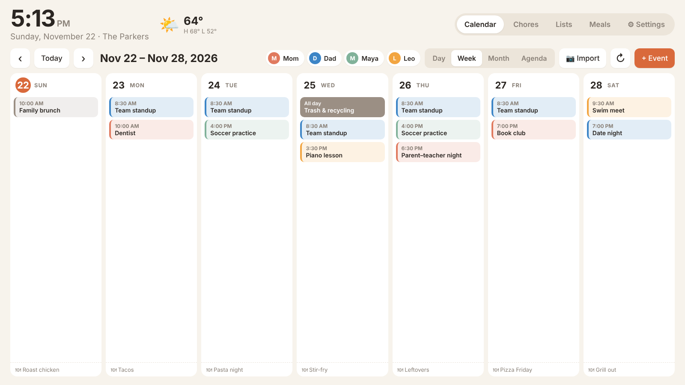
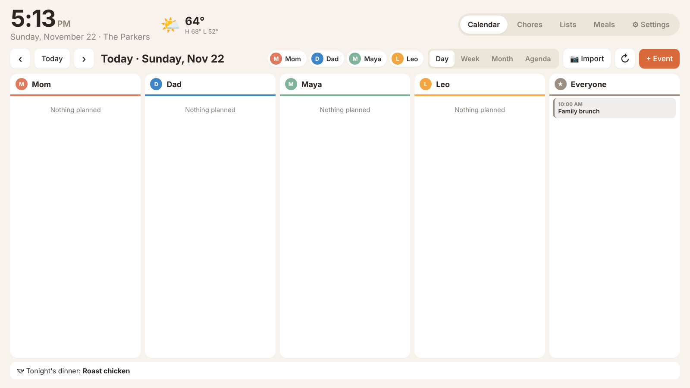
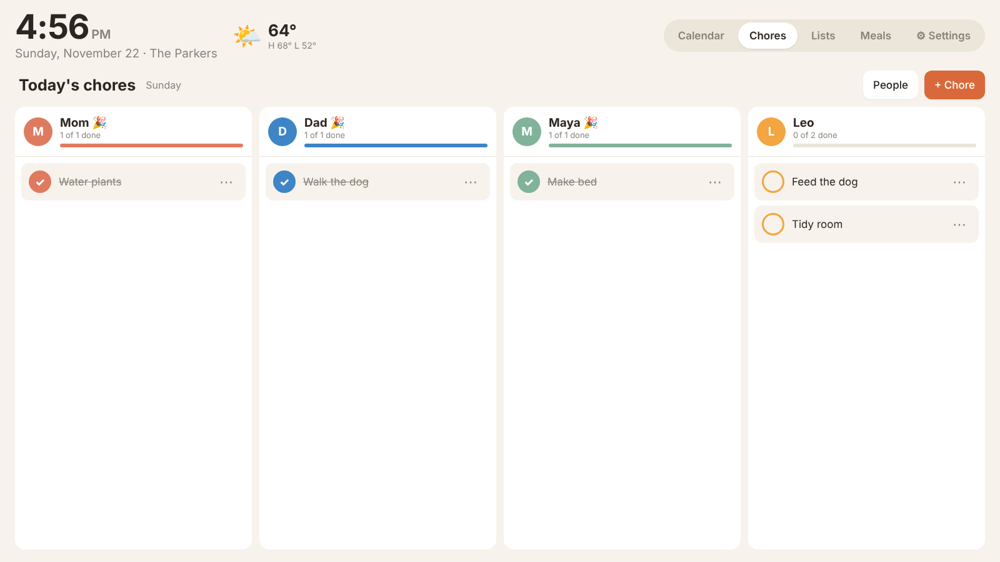
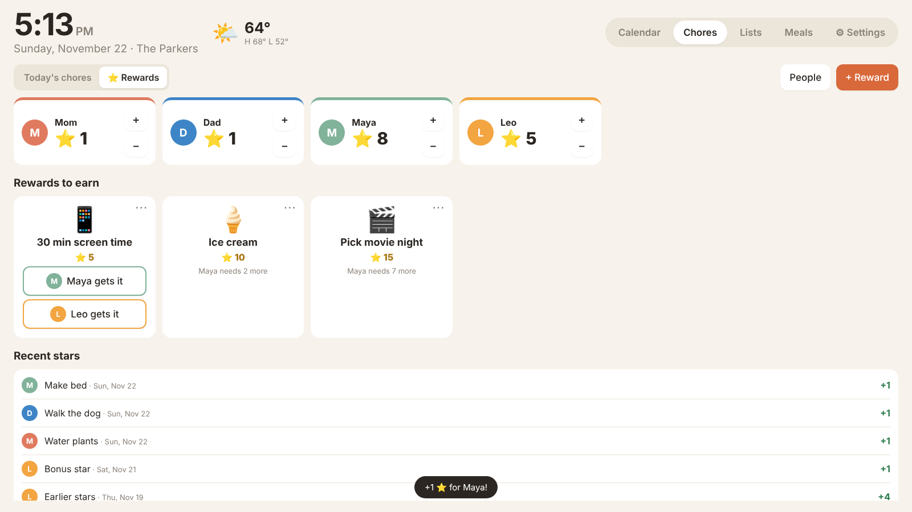
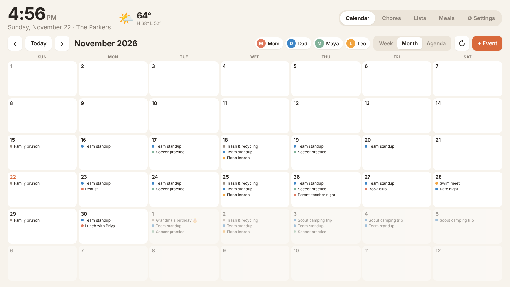
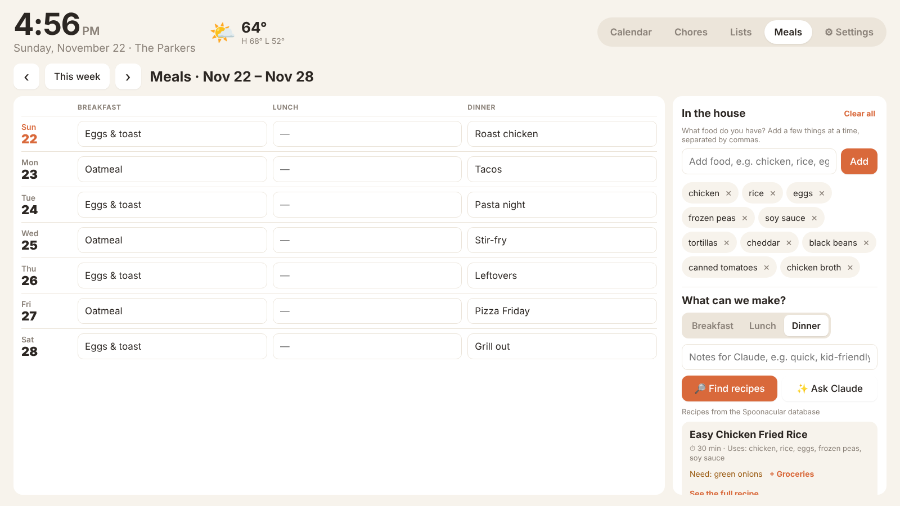
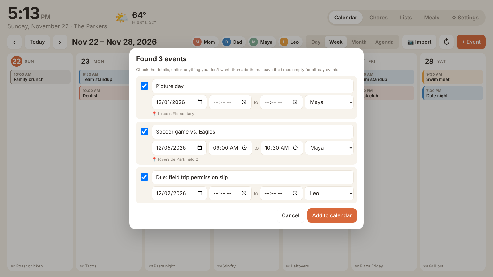
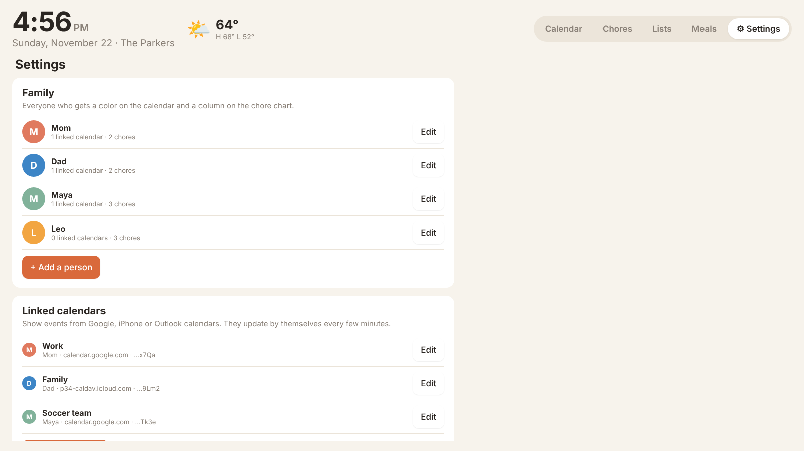
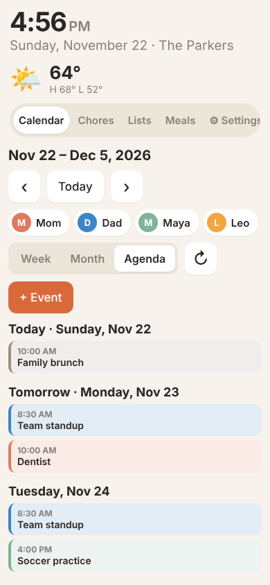

<p align="center"></p>

<h1 align="center">Hearth</h1>

<p align="center"><b>A DIY family wall calendar.</b><br>
Shared calendar, chore chart, lists and meal planner on a touchscreen in your kitchen.<br>
Self-hosted, no subscription, set up entirely on screen.</p>

<p align="center"></p>

## Features

- **Family calendar:** day (a column for each person), week, month and agenda views, with a color for each person and filters to show or hide anyone.
- **Your existing calendars:** link Google, iPhone/iCloud and Outlook calendars by pasting their private link. They update by themselves every few minutes, and a ↻ button checks right away.
- **Add events anywhere:** from the wall screen, or from any phone or computer on your home Wi-Fi.
- **📷 Snap a flyer (optional):** photograph a school flyer, upload a PDF schedule or paste an email. Claude finds the dates, and you check them before they're added.
- **Chore chart with star rewards:** a column for each person, chores that repeat on chosen days, and stars for finishing them. Kids spend stars on rewards you choose ("30 min screen time", "pick dinner"); spending is PIN-protected.
- **Lists:** groceries, to-dos, packing lists and anything else.
- **Meal planner:** plan breakfast, lunch and dinner for the week. Tonight's dinner shows on the calendar.
- **Pantry and recipes (optional):** list the food in the house and find real recipes that use it (free [Spoonacular](https://spoonacular.com/food-api) key), or ask Claude for ideas (Claude API key). Missing ingredients go to the grocery list in one tap.
- **Set up on screen:** a first-run walkthrough and a Settings page, with no config files. Settings can be locked with a PIN.
- **Safe to use away from home:** an optional family-password sign-in for devices outside your home Wi-Fi. The wall screen never has to sign in.
- **Weather, clock, night mode and text size.** The screen goes dark overnight and returns to today when nobody's using it.
- **Reliable:** stores data in MariaDB/MySQL (it creates its own database) or plain files, and keeps showing the last copy if the server goes down.

| Day view | Chores | Star rewards |
|---|---|---|
|  |  |  |

| Month | Meals and recipes | Snap a flyer |
|---|---|---|
|  |  |  |

| Settings | Phone |
|---|---|
|  |  |

**Try the demo:** download the repo and open `static/index.html` in a browser. With no server, it runs a demo with a sample family.

## How it fits together

```
 [touchscreen + Raspberry Pi]  ── browser ──►  [Hearth container]  ──►  [MariaDB]  (optional)
 [phones on home Wi-Fi]        ── browser ──►        │
                                                     └──► Google / iCloud / Outlook calendar links
```

Hearth is one small Python server plus a single-page app. The wall screen is just a full-screen web browser pointed at it.

## Install

Pick one:

| You have… | Follow |
|---|---|
| An **Unraid** server | [docs/UNRAID.md](docs/UNRAID.md): fill in a form in the Docker tab, no terminal needed |
| Any machine with **Docker** | [Docker Compose](#docker-compose) below |
| Just a **Raspberry Pi** | [docs/RASPBERRY-PI.md](docs/RASPBERRY-PI.md): runs everything on the Pi |

Then set up the wall screen with [docs/RASPBERRY-PI.md → Wall screen](docs/RASPBERRY-PI.md#wall-screen).

### Docker Compose

```bash
git clone https://github.com/hartk1213/hearth_calendar.git hearth
cd hearth
cp .env.example .env        # set TZ; add database details only if you want MariaDB
docker compose up -d
```

Open `http://<that-machine>:8095` and follow the setup screens. With no database configured, data is stored in `./data`.

The image is published for both `amd64` and `arm64` as `ghcr.io/hartk1213/hearth`.

## Hardware for the wall screen

| Part | Notes |
|---|---|
| Raspberry Pi 5 (2 GB) | It only runs a browser, so 2 GB is plenty. A used mini PC or thin client also works. |
| Touch monitor, 15.6" to 27" | It must send touch over **USB** (driver-free on Linux). Prefer projected-capacitive (PCAP) touch and VESA 100×100 mounting holes. |
| Pi power supply, 32 GB microSD, micro-HDMI to HDMI cable, USB cable | Right-angle plugs let the screen sit flush against the wall. |
| VESA wall mount | Screw it into studs for screens 24" and up. |

## Optional: recipes, meal ideas and flyer import

Both are off until you add a key in **Settings**. Keys are stored on the server only and never sent to browsers.

- **Recipe database:** real recipes with photos and full steps, matched to your pantry, from Spoonacular. The free plan covers a few searches a day. Hearth remembers results for 6 hours, and one search covers breakfast, lunch and dinner.
- **Claude (one key, two features):** **📷 Import** turns photos, PDFs and pasted emails into events, which you review before they're added. **Meal ideas** suggests dishes from what you have, following your notes (e.g. "quick, no pork"). This needs a Claude API key from [platform.claude.com](https://platform.claude.com); Anthropic bills the account per use.

## Updating

```bash
docker compose pull && docker compose up -d     # Docker Compose
```

On Unraid, click **Apply update** next to Hearth in the Docker tab. Your data and settings are kept.

## Privacy and security

- Calendar links, API keys and the PIN are stored on your server only. The app shows just a short hint of each.
- **Away from home:** before putting Hearth on a public web address (e.g. with Nginx Proxy Manager), turn on **Settings → Sign-in for away from home**. Devices outside your home network then need the family password once; devices at home, including the wall screen, don't. Hearth reads the visitor's address from your proxy's `X-Real-IP` / `X-Forwarded-For` header, and only trusts those headers from a proxy on your own network. Repeated wrong passwords are locked out for 15 minutes.
- At home, anyone on your Wi-Fi can open Hearth. The PIN protects Settings and spending stars. For a private-network option instead of a public address, look at Tailscale.
- Linked calendars are read-only. Hearth never changes your Google, iCloud or Outlook calendars.

## FAQ

**Do events I add in Hearth go to Google Calendar?** No. Linked calendars are read-only, so events added in Hearth live in Hearth. Add an event in the Google Calendar app and it appears on the wall within the check interval (2 to 30 minutes, set in Settings), or right away with ↻.

**I forgot the Settings PIN.** With MariaDB: `UPDATE hearth_state SET data = JSON_SET(data, '$.pin_hash', '') WHERE id = 2;` then restart Hearth. With file storage: remove the `pin_hash` value in `data/settings.json`, then restart.

**I forgot the family password.** At home, open Settings → Sign-in → Change password (home devices don't need to sign in, unless it's set to "Every device"). If you're locked out completely, with MariaDB run: `UPDATE hearth_state SET data = JSON_SET(data, '$.auth_mode', 'off') WHERE id = 2;` and restart Hearth. With file storage, set `"auth_mode": "off"` in `data/settings.json`.

**Times are off by a few hours.** Set `TZ` to your time zone (e.g. `America/Chicago`) and restart.

## Development

```bash
python -m venv .venv && . .venv/bin/activate
pip install -r requirements.txt
python server.py                                 # http://localhost:8080, stores data next to server.py
python -m unittest discover -s tests -v          # smoke tests
```

- `server.py`: standard-library HTTP server; settings, state, calendar (ICS) feeds and optional APIs
- `static/index.html`: the entire app (vanilla JS, no build step)
- Storage: MariaDB/MySQL when `DB_HOST` is set, otherwise `data.json` and `settings.json`

Pull requests are welcome. Please keep it dependency-light and friendly for non-technical families.

## License

[MIT](LICENSE)
